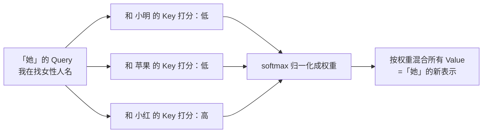
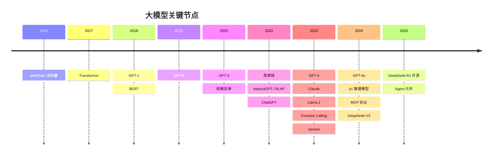

# 01 从 Transformer 到 ChatGPT：大模型简史

> 系列：AI 学习系列教程 · 第一部分 大模型基础
> 配套示例：`pi-leaning-examples/part1-basics/src/01-attention.ts`

这个系列的终点是自己写 agent。但在写第一行调用 API 的代码之前，值得花一篇的时间弄清楚：我们调用的这个东西到底是什么，它是怎么一步步变成今天这样的。

很多在工程上让人困惑的现象，回到历史里都有答案。为什么模型"一个字一个字往外蹦"？为什么它会一本正经地胡说？为什么同一个问题问两次答案不一样？为什么所有厂商的接口都长得像"一个消息列表"？这些都不是随意的设计，而是技术路线留下的痕迹。

本篇按时间顺序讲五件事：Transformer 之前的困境、注意力机制的直觉、GPT 系列与规模定律、ChatGPT 为什么会说话、以及之后的格局。

## 一、Transformer 之前：让机器读懂一句话有多难

### 1.1 先把词变成数字

计算机只会算数，所以第一步是把词变成数字。最朴素的办法是给词表里每个词编号，但编号之间没有意义：「猫」是 1023、「狗」是 4711，看不出它们都是动物。

2013 年 Google 的 word2vec 换了个思路：把每个词表示成一串几百维的浮点数，也就是**向量**，并且让经常出现在相似上下文里的词，向量也彼此靠近。训练完之后，人们发现向量之间居然能做"语义算术"，最有名的例子是：

```
vec(国王) - vec(男人) + vec(女人) ≈ vec(女王)
```

这个想法一直沿用到今天。你调用的每个大模型，进去的第一步都是把文字切成 token、再把每个 token 查表变成一个向量。这个"切"和"查表"会在下一篇细讲。

### 1.2 RNN：一个字一个字地读

有了词向量，还要理解整句话。2014 年前后的主流是**循环神经网络**（RNN）及其改进版 LSTM。它的工作方式很像人逐字阅读：读一个词，更新一次脑子里的"记忆"，再读下一个词。

这个结构有两个硬伤：

- **记性差。** 记忆是一个固定大小的向量，句子越长，开头的信息被冲刷得越厉害。读到第 100 个词时，第 1 个词说了什么已经很模糊了。
- **没法并行。** 第 10 个词的计算必须等第 9 个词算完。GPU 擅长的是同时算一大堆东西，RNN 却只能排队，训练大模型几乎不可能。

2014 年机器翻译领域出现了一个补丁：在生成译文的每一步，允许模型"回头看"原文的所有位置，并决定此刻该重点看哪里。这就是**注意力机制**（attention）的雏形。当时它只是 RNN 的配件。

## 二、2017：Attention Is All You Need

2017 年 6 月，Google 的八位研究者发表论文《Attention Is All You Need》，提出了 **Transformer** 架构。标题本身就是结论：不要 RNN 了，只用注意力就够。

这篇论文最初只是为了做机器翻译，但它提出的架构后来成了几乎所有大模型的底座。理解它的核心，也就是**自注意力**（self-attention），是理解大模型的关键一步。下面只讲直觉，不推公式。

### 2.1 一个代词引出的问题

看这句话：

> 小明把苹果给了小红，因为**她**饿了。

人一眼就知道「她」指的是小红。但对机器来说，这需要做一件事：在处理「她」这个词的时候，去句子里找出和它最相关的词，并把那个词的信息"借"过来。

自注意力做的正是这件事。而且不只是「她」，**句子里的每个词都会做一遍**：拿自己和句子里所有的词逐一比较，看谁和自己关系最紧，再按关系远近把它们的信息融合进来。这些比较彼此独立，可以同时算完，这也是 Transformer 比 RNN 快的原因。

### 2.2 Query、Key、Value：一次图书馆检索

自注意力给每个词准备三个向量，可以用一次图书馆检索来类比：

| 向量 | 类比 | 含义 |
|---|---|---|
| Query（查询） | 你手里的检索需求 | 「她」在问：我指的是谁？我要找一个女性人名 |
| Key（键） | 每本书书脊上的标签 | 每个词对外宣称"我是什么"：小红说"我是女性人名"，苹果说"我是食物" |
| Value（值） | 书的内容 | 一个词被选中后真正交出去的信息 |

检索过程分三步：

1. **打分**：拿「她」的 Query 去和每个词的 Key 比一比相似度，数学上就是做点积。和「小红」的 Key 最像，分数最高。
2. **归一化**：把分数用 softmax 变成一组加起来等于 1 的权重。比如小红 0.5、她自己 0.4、其他词各占一点。
3. **加权汇总**：按这组权重，把所有词的 Value 混合起来，作为「她」这个位置的新表示。于是「她」的向量里融进了大量"小红"的信息。



写成公式就是论文里那一行，看个样子即可：

```
Attention(Q, K, V) = softmax(Q · Kᵀ / √d) · V
```

其中除以 √d 只是为了让数值不至于过大，d 是向量的维度。

配套示例用手工设定的两维向量把这三步跑了一遍，不依赖任何库：

```bash
pnpm --filter part1-basics exec tsx src/01-attention.ts
```

输出大致是这样：

```
「她」对句中每个词的注意力权重：

小明　 0.040  ██  → [主语男孩]
苹果　 0.030  █  → [食物]
小红　 0.513  █████████████████████  → [女孩·小红]
她　　 0.386  ███████████████  → [代词]
饿　　 0.030  █  → [饥饿状态]
```

核心代码只有几行：

```ts
// 打分：Query 和每个 Key 做点积，除以 √d
const scores = K.map((k) => dot(queryOfShe, k) / Math.sqrt(d));
// 归一化：权重之和为 1
const weights = softmax(scores);
```

真实模型和这个玩具有三点不同，但思路完全一致：

- 向量有几千维，每一维的含义不是人能直接读懂的。Q、K、V 也不是手工设的，而是训练出来的。
- 有很多组注意力同时工作，叫**多头注意力**（multi-head）。有的头擅长找指代关系，有的头关注语法结构，有的头关注相邻的词，各司其职。
- 这样的层叠了几十上百层。底层处理字面关系，越往上越抽象。

### 2.3 为什么它赢了

对比 RNN 的两个硬伤：

- **记性**：任意两个词之间都直接计算相关度，第 1 个词和第 1000 个词的距离和相邻词一样近，不存在被"冲刷"的问题。
- **并行**：每个词对所有词的打分互不依赖，可以一次性在 GPU 上算完。这让"把模型做大"第一次在工程上可行。

代价也很明确：每个词都要和所有词算一遍，计算量随长度平方增长。这是**上下文窗口**有上限、长上下文更贵的根本原因之一，我们在下一篇讲计费时还会碰到它。

### 2.4 一个重要的分叉

Transformer 原本由两半组成：读原文的**编码器**和写译文的**解码器**。2018 年，两条路线各取了一半：

- **GPT**（OpenAI，2018 年 6 月）只用解码器，只做一件事：**根据前文预测下一个词**。
- **BERT**（Google，2018 年 10 月）只用编码器，擅长"理解"：分类、抽取、搜索排序。

当时 BERT 风头更盛。几年后，赢下一切的却是看起来更笨的 GPT 路线。

## 三、GPT 系列与规模定律：大力出奇迹

### 3.1 一个极其简单的训练目标

GPT 的训练目标简单到让人怀疑：给模型一段文字的前半截，让它猜下一个 token 是什么，猜错了就调整参数。把互联网上海量的文本拿来，一遍遍地做这个"完形填空"。这叫**预训练**。

这个目标直接决定了你今天看到的现象：

- 模型生成回答时，是**预测一个 token、把它接到末尾、再预测下一个**，循环往复。这就是"逐字输出"，也是为什么几乎所有应用都要用流式接口。
- 每一步预测出的其实是一个概率分布：下一个词是「的」有 30%，是「了」有 20%……从中抽样就会有随机性。`temperature` 参数控制的就是这个抽样有多"大胆"。
- 模型学到的是"什么样的文字看起来合理"，而不是"什么是真的"。当它不知道答案时，它依然会生成看起来合理的文字。这就是**幻觉**的来源。

### 3.2 从 GPT-1 到 GPT-3

| 年份 | 模型 | 参数量 | 意义 |
|---|---|---|---|
| 2018 | GPT-1 | 约 1.17 亿 | 证明"先预训练、再微调"在多种任务上有效 |
| 2019 | GPT-2 | 15 亿 | 能写出连贯的长文，OpenAI 一度以担心滥用为由分阶段发布 |
| 2020 | GPT-3 | 1750 亿 | 不用微调，只在提示词里给几个例子就能完成新任务 |

GPT-3 带来的那个能力有专门的名字：**上下文学习**（in-context learning）。你在提示词里写三个"中文→英文"的例子，再给它一句新的中文，它就会翻译，参数一点没变。

这件事对工程师的意义是巨大的：**提示词成了编程接口**。后面我们给模型写系统提示、定义工具描述，本质上都是在利用这个能力。

### 3.3 规模定律

2020 年 1 月，OpenAI 发表了关于**规模定律**（scaling laws）的研究：模型的效果随参数量、数据量、计算量的增加，以相当平滑、可预测的方式提升。2022 年 DeepMind 的 Chinchilla 研究又修正了配比，指出很多模型"参数太多、数据太少"，数据量应该和参数量同步增长。

规模定律把大模型从"做研究"变成了"做工程"：既然投入和效果的关系可以预测，那就可以理直气壮地去买更多的 GPU、收集更多的数据。此后几年行业的军备竞赛，根源在这里。

伴随规模而来的还有所谓**涌现**：某些能力在小模型上几乎没有，到某个规模突然出现，比如多步算术、按步骤推理。2022 年的"思维链"（chain-of-thought）研究发现，只要在提示词里让模型"一步一步想"，复杂问题的正确率就会明显提升。需要说明的是，后来也有研究指出部分"突然出现"是评测指标造成的错觉，能力其实是平滑增长的。这个争论至今仍在，但"大模型能做小模型做不了的事"这一点没有争议。

## 四、ChatGPT：从"续写"到"对话"

### 4.1 GPT-3 不听话

GPT-3 很强，但很难用。它本质上是一个续写机器：你问"怎么做红烧肉？"，它可能接着写出另外三个菜谱问题，因为在网页上，问题后面常常跟着更多问题。要让它回答，得精心设计提示词，把问题伪装成一篇文章的开头。

### 4.2 InstructGPT 与 RLHF

2022 年初，OpenAI 发表 InstructGPT，用三步把一个续写模型调教成一个助手：

1. **监督微调**（SFT）：请人写一批"指令 + 理想回答"的示范，让模型照着学。
2. **训练奖励模型**：让模型对同一个问题生成多个回答，请人排序哪个更好，再训练一个"打分模型"来模仿人的偏好。
3. **强化学习**：让模型不断生成回答、由打分模型评分，朝着得分更高的方向调整。

后两步合起来叫**基于人类反馈的强化学习**（RLHF）。效果惊人：参数只有 13 亿的 InstructGPT，在人类评价里胜过了 1750 亿参数的原版 GPT-3。规模之外，"对齐人的意图"成了另一条提升路径。

### 4.3 2022 年 11 月 30 日

ChatGPT 本质上就是把这套方法用在更强的模型上，再套上一个聊天界面。它发布后约两个月，月活用户就被广泛报道突破了一亿，是当时增长最快的消费级应用。

从工程角度看，ChatGPT 确立了一个沿用至今的形态：**对话就是一个消息列表**。每条消息有一个角色：`system` 定规矩，`user` 是用户说的话，`assistant` 是模型的回答。模型本身并没有"记忆"，所谓多轮对话，是每一轮都把完整的历史重新发给它。下一篇我们会看到，这个"每次重发"直接决定了上下文管理和计费的方式。

```json
[
  { "role": "system", "content": "你是一个乐于助人的助手。" },
  { "role": "user", "content": "怎么做红烧肉？" },
  { "role": "assistant", "content": "先把五花肉切块焯水……" },
  { "role": "user", "content": "不放糖可以吗？" }
]
```

最后一句"不放糖可以吗"之所以能被理解，是因为前面三条消息被一起发了过去，而不是模型"记得"。

## 五、之后的格局：百花齐放

ChatGPT 之后，节奏骤然加快。下面挑和本系列关系最大的几条线。

### 5.1 闭源三强

- **OpenAI**：2023 年 3 月 GPT-4 发布，开始支持图片输入。2023 年 6 月推出 **function calling**，模型第一次能以结构化的方式"请求调用一个函数"，这是第三部分的主角。2024 年的 GPT-4o 把文本、语音、图像放进一个模型，同年 9 月的 o1 开启了"推理模型"路线。
- **Anthropic**：由 OpenAI 前成员创立，2023 年 3 月发布 Claude。它较早支持超长上下文，在编程和长文档场景口碑突出。2024 年 11 月发布 **MCP 协议**，把工具从应用里拆成独立服务，这是第三部分的另一个主角。之后推出的 Claude Code 让"在终端里干活的 agent"成为一个热门品类。
- **Google**：Transformer 的诞生地，2023 年 12 月发布 Gemini，原生多模态，并在超长上下文上持续加码。

三家的接口形态各不相同，这就是第二部分要专门对比的内容。

### 5.2 开源与开放权重

- **Meta Llama**：2023 年 2 月发布 LLaMA，7 月发布可商用的 Llama 2，引爆了开源社区。一大批微调模型和本地运行工具由此诞生。
- **Mistral**：法国团队，2023 年 9 月发布 Mistral 7B。年底的 Mixtral 把**混合专家**（MoE）架构带进主流：模型总参数很大，但每次只激活其中一部分，推理成本更低。
- **Qwen**（阿里通义千问）：2023 年 8 月开始开源，尺寸齐全，中文能力强，是开源生态里被二次开发最多的系列之一。
- **DeepSeek**：2024 年 12 月的 V3 以相对低的训练成本达到一线水平。2025 年 1 月开源的 R1 用强化学习训练出了接近 o1 的推理能力，并以 MIT 协议放出权重。它让业界重新评估"推理能力必须靠巨额投入"的判断，也让推理模型迅速普及。

开放权重的意义对开发者很实际：模型可以下载到本地运行，数据不出内网。同时，各种本地推理框架几乎都提供"OpenAI 兼容"的接口，第二部分会专门讲这种"兼容"的真实程度。

### 5.3 国产模型

除了 Qwen 和 DeepSeek，国内还有 Kimi（月之暗面）、GLM（智谱）、MiniMax、豆包（字节跳动）等主要玩家。它们大多提供 OpenAI 兼容接口，部分也提供 Anthropic 兼容接口，价格普遍有竞争力。本系列的示例会尽量覆盖一两家国产模型，让你看到真实接入时会踩的坑。

### 5.4 两个新趋势

**推理模型。** 从 o1 和 R1 开始，模型在给出答案前会先生成一段"思考过程"。它们在数学、编程、多步规划上明显更强，代价是更慢、更贵。在接口层面，思考内容和最终回答是分开返回的，各家的字段名还不一样，这是第二部分的内容。

**Agent。** 当模型能可靠地调用工具，下一步自然是让它自己循环：想一步、调一个工具、看结果、再想下一步，直到把事做完。2025 年常被称为"Agent 元年"，编程 agent、浏览器 agent、各种自动化助手大量出现。这正是本系列第四、五部分要动手做的事。

### 5.5 一张时间线



模型的发布节奏极快，本文写作时（2026 年下半年）各家都已迭代了多个大版本。具体的模型名和能力排名会过时，以各家官方文档为准，但上面这条技术主线是稳定的。

## 六、这段历史对写代码的人意味着什么

把上面的内容压缩成几条工程上的推论，后面每一篇都会用到：

1. **模型是一个"预测下一个 token"的函数。** 输入一个消息列表，输出一段续写。它没有状态，没有记忆，对话历史要你每次都发过去。
2. **输出是逐个生成的。** 所以要用流式接口，所以输出越长越慢越贵，所以会有"输出被截断"这种情况。
3. **输出带有随机性，而且可能是错的。** 模型说"我已经帮你改好了"，不代表任何东西被改了。在我们最终要做的表格 agent 里，这条会被做成一条设计原则：**模型的话不算数，只有工具调用和代码校验算数。**
4. **提示词就是编程接口。** 系统提示、工具描述、上下文的组织方式，都会实实在在地影响结果。
5. **上下文是有限的、有成本的。** 窗口有上限，每个 token 都要计费。后面讲 agent 时，"上下文工程"会是一个单独的话题。

## 小结

- Transformer 用自注意力替代了 RNN：每个词同时和所有词计算相关度，既解决了长距离依赖，又能并行训练。
- 自注意力可以理解为一次检索：Query 去匹配每个词的 Key，按相似度加权汇总 Value。
- GPT 路线只做"预测下一个词"，靠规模定律一路做大，在 GPT-3 上出现了上下文学习。
- RLHF 让模型从"续写"变成"听话的助手"，ChatGPT 确立了"消息列表 + 角色"的对话形态。
- 之后是闭源三强、开源生态与国产模型并起，推理模型和 agent 是最新的两条主线。

下一篇《02 使用大模型前必须懂的核心概念》，我们从 token 讲起：它怎么切、怎么计费、上下文窗口到底装的是什么，以及 temperature、流式输出、推理模型、prompt caching 这些你在每个 API 文档里都会碰到的词。

## 延伸阅读

- Vaswani et al., *Attention Is All You Need*, 2017.
- Jay Alammar, *The Illustrated Transformer*，经典的图解入门。
- Kaplan et al., *Scaling Laws for Neural Language Models*, 2020.
- Brown et al., *Language Models are Few-Shot Learners*（GPT-3 论文）, 2020.
- Wei et al., *Chain-of-Thought Prompting Elicits Reasoning in Large Language Models*, 2022.
- Ouyang et al., *Training language models to follow instructions with human feedback*（InstructGPT 论文）, 2022.
- DeepSeek-AI, *DeepSeek-R1: Incentivizing Reasoning Capability in LLMs via Reinforcement Learning*, 2025.
