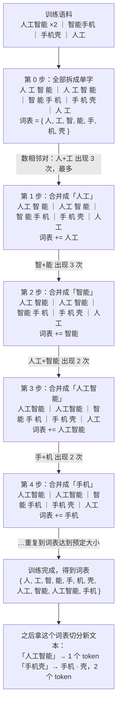

# 02 使用大模型前必须懂的核心概念

> 系列：AI 学习系列教程 · 第一部分 大模型基础
> 配套示例：`ai-learning-examples/part1-basics/src/02-tokens.ts`、`02-sampling.ts`、`02-sse.ts`

上一篇讲了大模型是怎么来的，结论是：它是一个"根据前文预测下一个 token"的函数。这一篇把这句话拆开，逐个讲清楚你在任何一家 API 文档里都会碰到的概念。

这些概念看起来零散，其实都能从那句话推出来。token 是它读写的单位，上下文窗口是它一次能看多少，temperature 决定它怎么从概率里挑词，流式输出是因为它一次只吐一个，prompt caching 是因为每次都要重读一遍前文。理解了这层关系，后面看 API 参数时就不用死记硬背。

## 一、token：模型读写的最小单位

### 1.1 模型不认识"字"

模型并不直接处理文字，而是先由分词器（tokenizer）把文字切成一个个 token，每个 token 对应词表里的一个整数编号。模型输入的是编号序列，输出的也是编号，最后再还原成文字。

现在主流的分词方法叫 BPE（字节对编码）。它的思路很直观：先把文字拆成最小的字节，再统计语料里哪些相邻片段最常一起出现，就把它们合并成一个新 token，反复合并到词表达到预定大小为止。所以常见的词会成为一个完整的 token，罕见的词会被拆成几块。

用一个很小的例子走一遍这个过程。假设我们手头的训练语料只有下面 5 个词（真实语料是海量文本，这里只为演示）：

| 词 | 出现次数 |
|---|---|
| 人工智能 | 2 |
| 智能手机 | 1 |
| 手机壳 | 1 |
| 人工 | 1 |

BPE 的输入就是这堆文本。真实实现会先拆到字节（一个汉字占 3 个字节），这里为了看得清楚，简化为拆到单个汉字。接下来每一轮都做同一件事：数一数哪两个相邻片段一起出现得最多，把它们合并成一个新 token：



每一步只做一件事：找出当前最常相邻的一对，合并成一个新 token 加进词表。词表里的 token 因此天然带着"出现频率"的信息，训练语料里越常见的片段越完整。

配套示例用 OpenAI 的 o200k_base 编码看看实际效果：

```bash
pnpm --filter part1-basics exec tsx src/02-tokens.ts
```

```
  4 token  Hello, world!
          [Hello][,][ world][!]

  4 token  你好，世界！
          [你好][，][世界][！]

 16 token  敏捷的棕色狐狸跳过了那只懒狗。
          [敏][捷][的][·][·][色][狐狸][跳][过][了][那][只][·][·][狗][。]

 12 token  2026-10-25 12:34:56
          [202][6][-][10][-][25][ ][12][:][34][:][56]

  6 token  antidisestablishmentarianism
          [ant][idis][est][ablishment][arian][ism]
```

从这些输出里能看出分词器的脾气。常用词会被当成一个整体，「你好」「世界」「狐狸」各占一个 token，英文单词连同它前面的空格也常常算作一个。生僻字就没这么好的待遇了，「棕」和「懒」各被拆成两个字节级的 token，单独解码出来是乱码，示例里用 `·` 标了出来。数字切得尤其碎，一个日期被切成了 12 块，这也是模型做精确算术容易出错的原因之一：它看到的不是一个数，而是几段数字碎片。长单词则按词根切开，一个 28 个字母的单词只用了 6 个 token。

### 1.2 中文和英文"价格"不同

示例最后把同一段意思分别用中文和英文写了一遍：

```
中文：87 个字符 → 53 token，平均每 token 1.64 个字符
英文：246 个字符 → 44 token，平均每 token 5.59 个字符
```

同样的意思，中文用了更多的 token。早期的分词器对中文更不友好，一个汉字常常要一到两个 token；新一代分词器和国产模型的分词器专门扩充了中文词表，情况好了很多。

还要注意，各家厂商的分词器并不相同，同一段文字在 GPT、Claude、Qwen、DeepSeek 上算出来的 token 数会有出入，不能拿一家的结果去估算另一家。平时粗略估算，可以按一个汉字约一个 token、一个英文单词约 1.3 个 token 来算，宁可多估一点。真实的用量，以 API 响应里返回的 `usage` 字段为准。

### 1.3 为什么要关心 token

因为大模型应用里的几件大事都以 token 为单位来衡量。厂商按你输入了多少 token、模型输出了多少 token 来收钱；一次请求能装下多少内容，由上下文窗口的 token 上限决定；模型的生成速度也是按每秒多少 token 来算的，输出越长，等得越久。后面三节分别展开这三件事。

## 二、上下文窗口：模型一次能"看"多少

### 2.1 窗口里装的是什么

上下文窗口（context window）是模型单次请求能处理的 token 总数上限。现在主流模型的窗口从十几万到上百万 token 不等。

很多人以为窗口里装的只是"我发的问题"，实际上一次请求里所有东西都要占窗口：

```
┌──────────────────── 上下文窗口 ────────────────────┐
│ 系统提示                                           │
│ 工具定义（每个工具的名字、描述、参数 schema）      │
│ 历史对话（之前每一轮的 user 和 assistant 消息）    │
│ 工具调用和工具结果（读到的文件、网页、查询结果）   │
│ 图片、文档                                         │
│ 本轮的用户消息                                     │
├────────────────────────────────────────────────────┤
│ 模型本轮的输出（含推理模型的思考过程）             │
└────────────────────────────────────────────────────┘
```

注意最后一行，输出也占窗口。输入已经用掉 120K 的话，128K 窗口的模型最多只能再输出 8K。

在写 agent 时，工具定义和工具结果往往是大头。一个工具的 schema 可能有几百 token，读一个文件可能就是上万 token。这就是为什么后面我们会单独讲"上下文工程"。

### 2.2 max_tokens：给输出设上限

请求里的 `max_tokens`（有的接口叫 `max_output_tokens` 或 `maxOutputTokens`）限制的是本次输出最多多少 token。它有两个作用：控制成本和延迟，以及防止模型无限制地写下去。

输出达到上限时，模型会在半句话处停下，响应里的结束原因会标成 `length`（各家叫法不同，后面讲）。在普通聊天里这只是一句话没说完；但如果模型正在输出一段 JSON 或一个工具调用的参数，被截断就意味着 JSON 不完整、解析失败。这是工程上非常常见的一类 bug，第五部分会专门处理它。

### 2.3 上下文不是记忆

上一篇说过，模型没有状态。每次请求都是独立的，它对之前对话的"记得"，完全来自你在这次请求里把历史一起发了过去。

这带来一个容易被忽略的后果：多轮对话的成本是累积的。假设每轮用户说 100 token、模型回答 300 token：

| 轮次 | 本轮输入 | 本轮输出 | 累计输入 |
|---|---|---|---|
| 1 | 100 | 300 | 100 |
| 2 | 100 + 400 = 500 | 300 | 600 |
| 3 | 500 + 400 = 900 | 300 | 1500 |
| 10 | 3700 | 300 | 19000 |

第 10 轮时，单次输入已经是第 1 轮的 37 倍，累计输入随轮数大致按平方增长。应用里的"新建对话"按钮、历史裁剪、摘要压缩，都是为了对付这件事。

另外，窗口装得下不等于模型用得好。研究和实践都发现，信息放在超长上下文的中间位置时，模型更容易忽略它。重要的指令放在开头或结尾，比埋在中间更可靠。

## 三、计费：输入和输出分开算

### 3.1 计价的基本结构

几乎所有厂商都按"每百万 token 多少钱"报价，而且输入和输出是分开计价的，输出通常要贵好几倍。原因在于输入可以一次并行算完，输出却只能一个 token 一个 token 地生成。在这个基本结构之上还有几处细节：命中缓存的输入会便宜很多，这一点后面讲 prompt caching 时细说；推理模型的思考过程按输出计费，哪怕你根本看不到它；图片则按尺寸折算成 token，和文件大小无关。

具体价格变化很快，以各家官方定价页为准。下面用一个假设的价格演示怎么算：

```
假设：输入 2 元 / 百万 token，输出 8 元 / 百万 token

一次请求：输入 5,000 token，输出 1,000 token
费用 = 5,000 × 2 / 1,000,000 + 1,000 × 8 / 1,000,000
     = 0.010 + 0.008
     = 0.018 元
```

单次看很便宜，但 agent 一个任务可能循环几十步、每步都带着越来越长的上下文，费用会迅速放大。

### 3.2 从响应里读用量

每次调用的响应里都会返回实际用量，字段名各家不同，但含义一致：

```json
"usage": {
  "prompt_tokens": 5000,
  "completion_tokens": 1000,
  "prompt_tokens_details": { "cached_tokens": 4096 },
  "completion_tokens_details": { "reasoning_tokens": 600 }
}
```

这段是 OpenAI 风格的写法：输入 5000 token，其中 4096 命中缓存；输出 1000 token，其中 600 是看不见的思考。养成记录 `usage` 的习惯，是控制成本的第一步。

## 四、角色：消息列表里的几种身份

对话以消息列表的形式发送，每条消息有一个角色：

| 角色 | 谁说的 | 作用 |
|---|---|---|
| `system` | 开发者 | 设定身份、规则、输出格式。模型会比对待普通用户消息更重视它 |
| `user` | 用户 | 用户的输入 |
| `assistant` | 模型 | 模型之前的回答；你也可以伪造一条，引导模型的风格 |
| `tool` | 工具 | 工具执行的结果，第三部分的主角 |

```json
[
  { "role": "system", "content": "你是一个 Excel 助手，只用中文回答。" },
  { "role": "user", "content": "帮我做一个销售台账" },
  { "role": "assistant", "content": "好的，需要哪些列？" },
  { "role": "user", "content": "客户、金额、签约日期" }
]
```

这是最通用的形态，但各家在细节上不一样。有的把 system 放进消息列表，有的把它单独作为一个字段；OpenAI 新接口里还多了一个 `developer` 角色；工具结果的角色名也不统一。第二部分会逐家对比。

关于系统提示，有一点要澄清：它不是"安全边界"。系统提示只是让模型更倾向于遵守，并不能保证。用户在对话里绕过系统提示的例子很多。真正需要保证的事，要靠代码来做，而不是靠提示词。

## 五、生成参数：怎么从概率里挑词

### 5.1 temperature

上一篇说过，模型每一步输出的是一个概率分布。temperature 控制这个分布有多"尖"或多"平"。配套示例假设模型对「今天天气很___」的候选词打了分，看看不同 temperature 下的分布：

```bash
pnpm --filter part1-basics exec tsx src/02-sampling.ts
```

```
temperature = 0（每次都选最高分）
  好　　 100.0%  ████████████████████████████████████████
  抽 10 次：好 好 好 好 好 好 好 好 好 好

temperature = 0.5（更保守）
  好　　  74.1%  ██████████████████████████████
  热　　  15.0%  ██████
  冷　　   6.7%  ███
  抽 10 次：冷 好 好 好 好 好 不错 好 好 冷

temperature = 2.0（更发散）
  好　　  32.1%  █████████████
  热　　  21.5%  █████████
  冷　　  17.6%  ███████
  不错　  15.2%  ██████
  糟糕　   9.2%  ████
  奇怪　   4.3%  ██
  抽 10 次：糟糕 不错 好 冷 好 奇怪 不错 不错 不错 好
```

实现上它只做了一件事：在 softmax 之前把分数除以 temperature。

```ts
const scaled = logits.map((x) => x / temperature);
```

除以一个小于 1 的数，差距被放大，高分的更突出；除以一个大于 1 的数，差距被压平，低分的也有机会被选中。

### 5.2 top_p

top_p 是另一种控制随机性的方式：把候选词按概率从高到低排，只保留累计概率达到 p 的那些，其余直接砍掉。示例里 `top_p = 0.8` 时，只剩「好、热、冷」三个候选，「奇怪」这种长尾词永远不会被抽到。

### 5.3 怎么设

怎么设取决于你要的是稳定还是创意。抽取信息、生成 JSON、调用工具这类要求准确的任务，temperature 设成 0 或接近 0；写文案、头脑风暴这类需要发散的任务，可以调高到 0.8 到 1.0。temperature 和 top_p 一般只调其中一个，两个一起调，效果很难预测。

即使把 temperature 设成 0，也不能保证每次结果完全一样。服务端会把多个请求拼成一批来算，浮点运算的顺序因此每次略有不同，结果就可能出现细微差异。有的接口提供了 `seed` 参数，但也只是"尽量"复现。另外，推理模型常常不允许改这些参数，或者只接受默认值，传了反而会报错。

### 5.4 stop

`stop` 参数指定一个或多个字符串，模型一旦生成它们就立即停下。比如让模型生成一行 CSV，可以把换行符设为 stop。在工具调用普及之前，stop 是控制输出格式的重要手段，现在用得少了。

## 六、流式与非流式：两种取回结果的方式

### 6.1 等它写完，还是边写边看

模型是一个 token 一个 token 往外生成的，生成 1000 个 token 可能要十几秒。调用方拿结果的方式因此分成了两种。

默认的方式是非流式：服务端等模型全部生成完，再把完整的回答装进一个 JSON 一次性返回。这种方式写起来最简单，发一个请求、等一个响应、读一个字段就完事了。代价是用户要盯着空白的屏幕等上十几秒，看不出模型是在认真写，还是已经卡住了。

另一种是流式：在请求里加上 `stream: true`，服务端每生成一小段就立刻推送过来，客户端边收边显示，用户在一两秒内就能看到第一个字，后面的文字像打字机一样一段段冒出来。聊天界面、编程助手、agent 几乎都用流式，因为对人来说，"已经开始回答了"和"还在等"是完全不同的体验。

非流式也有它的位置。后台的批量任务没有人在屏幕前等，用流式只是平白多了拼接的工作；有些场景需要拿到完整的 JSON 才能往下处理，边收边显示也没有意义。还有一些简陋的兼容服务干脆只支持非流式，第 08 章会讲怎么识别它们。

### 6.2 响应体长什么样

先看非流式。以 OpenAI 风格为例，响应是一个普通的 JSON，完整的回答、结束原因和用量都在里面：

```json
{
  "choices": [
    {
      "message": { "role": "assistant", "content": "大模型是逐个 token 生成的。" },
      "finish_reason": "stop"
    }
  ],
  "usage": { "prompt_tokens": 12, "completion_tokens": 9 }
}
```

流式的响应则大多用 SSE（Server-Sent Events）协议。它是一个不会立刻关闭的 HTTP 响应，服务端不断往里写 `data: ...` 行，每个事件之间用一个空行隔开：

```
data: {"choices":[{"delta":{"content":"大"}}]}

data: {"choices":[{"delta":{"content":"模型"}}]}

data: {"choices":[{"delta":{},"finish_reason":"stop"}],"usage":{...}}

data: [DONE]
```

对照两段可以看出区别。非流式里是一个完整的 `message`，流式里每个事件只带一个增量 `delta`，客户端要自己把它们拼起来；结束原因和用量也不再和正文放在一起，而是出现在最后一个事件里（OpenAI 默认甚至不在流式里返回用量，要额外打开 `stream_options.include_usage`）；最后再以一个 `[DONE]` 收尾。

配套示例用写死的数据模拟网络分片，演示一个最小的解析器：

```bash
pnpm --filter part1-basics exec tsx src/02-sse.ts
```

解析时最需要留意的一点是，网络分片不会按事件边界来切。一个 TCP 包里可能只有半个 JSON，所以必须先把收到的内容攒进缓冲区，遇到空行才算一个完整的事件：

```ts
buffer += chunk;
while ((sep = buffer.indexOf('\n\n')) !== -1) {
  const event = buffer.slice(0, sep);
  buffer = buffer.slice(sep + 2);
  // 处理 event 里的 data: 行
}
```

实际开发中你通常不会手写这个，SDK 和第 09 章我们自己写的统一层都会封装好。但知道它的样子，抓包排查问题时会很有用。

### 6.3 怎么衡量"快"

有了流式，"快不快"就不再是一个数字能说清的事了，业界一般从几个角度来看。

最常被提到的是首 token 延迟，英文缩写 TTFT（Time To First Token），指从发出请求到收到第一个片段的时间。它决定了用户要盯着空白屏幕等多久，也是流式相比非流式最大的收益所在。影响它的因素有网络、服务端排队，以及模型读完你整段输入所花的时间，所以输入越长，首字往往越慢。推理模型的首字延迟里还包含了思考时间，长的可以到几十秒。

第一个字出来以后，用户关心的就变成了后面的字来得匀不匀、快不快。描述这件事的指标是 token 间延迟，英文缩写 ITL（Inter-Token Latency），也有人叫 TBT（Time Between Tokens），也就是相邻两次输出之间的等待时间。把它对所有输出取平均，就得到另一个常见指标 TPOT（Time Per Output Token），每个输出 token 平均要花多少时间，算法是用总耗时减去首字延迟，再除以输出的 token 数。很多地方说的"输出速度多少 token 每秒"，其实就是 TPOT 的倒数。

TPOT 和 ITL 的平均值在数值上差不多，看的东西却不一样。TPOT 只是一个平均数，ITL 则保留了每一次间隔。假如生成到一半卡顿了三秒，摊到几百个 token 上，平均值几乎看不出变化，但 ITL 里会出现一个三秒的长间隔，它的 P99 会一下子跳上去。用户感觉到的"一顿一顿"，靠的正是 ITL 的分布。最后，把首字延迟和全部输出时间加在一起，就是端到端延迟，也就是一次请求从发出到收完的总耗时，这是后台批量任务唯一关心的数字。

在客户端测这些指标时有一个坑。一个 SSE 事件里不一定只有一个 token，很多服务会把几个 token 攒在一起发，网络和中间的代理也可能把几个事件合并送达。所以客户端直接量到的是"事件之间的间隔"，并不等于真正的 token 间隔。估算 TPOT 时，应该用 `usage` 里报告的输出 token 数去除时间，而不是数收到了多少个事件。下一篇的配套示例 `03-latency.ts` 就是这么算的。

流式还有一个工程上的好处：既然数据是一段段来的，就可以按"多久没收到新数据"来判断连接是不是卡死了。非流式只能设一个很长的总超时，因为你无法区分"模型还在写"和"连接已经断了"；流式则可以设一个短得多的空闲超时，比如 30 秒没有任何新事件就中止。这其实就是把 ITL 的异常值当成了故障信号，第五部分会用到这一点。

### 6.4 结束原因

每次生成结束时，响应都会告诉你它为什么停下来。不论流式还是非流式，这都是一个必须检查的字段：

| 含义 | OpenAI | Anthropic | Gemini |
|---|---|---|---|
| 正常说完 | `stop` | `end_turn` | `STOP` |
| 达到输出上限，被截断 | `length` | `max_tokens` | `MAX_TOKENS` |
| 要调用工具 | `tool_calls` | `tool_use` | 返回 functionCall |
| 被内容安全拦截 | `content_filter` | `refusal` | `SAFETY` |

只看文本不看结束原因，是很多 bug 的根源：被截断的回答看起来也像一段正常的文字。流式时还要多留一个心眼，如果连接中途断了，你可能根本收不到带结束原因的那个事件，这时手里的文字同样是不完整的。

## 七、推理模型：先想后答

### 7.1 思考与回答分离

推理模型在给出答案前，会先生成一段思考过程（thinking / reasoning），在里面拆解问题、尝试、验证、纠错，然后才输出最终回答。这让它在数学、编程、多步规划上明显更强。

在接口层面，思考内容和最终回答是分开的，但各家的处理方式差别很大。有的把思考作为单独的字段或内容块完整返回，你可以展示给用户，也可以直接丢掉；有的只返回思考的摘要，甚至完全不返回原文，只在 `usage` 里告诉你用了多少思考 token。到了多轮对话或工具调用循环里，差异就更明显了：有的厂商要求你把上一轮的思考原样回传，有的则明确要求不要回传。这些都是第二部分的重点内容。

现阶段需要记住的是思考对成本和输出的影响。思考是按输出计费的，而且可能比回答本身还长。思考同样占用输出上限，`max_tokens` 设得太小，模型可能想到一半就被截断，连一个字的回答都没有给出来。好在思考的深度是可以控制的，各家都提供了"思考预算"或"推理强度"之类的参数，让你在质量、速度和成本之间做权衡。

### 7.2 什么时候用

推理模型不是越强越好。简单的问答、格式转换、信息抽取，普通模型更快更便宜；需要多步推理、写复杂代码、做规划时，推理模型的优势才明显。很多 agent 会混用：规划用推理模型，执行用普通模型。

## 八、多模态输入

主流模型都能接收图片，部分能接收 PDF、音频和视频。在 API 里，一条消息的内容不再是一个字符串，而是一个内容块数组：

```json
{
  "role": "user",
  "content": [
    { "type": "text", "text": "这张发票的金额是多少？" },
    { "type": "image_url", "image_url": { "url": "data:image/png;base64,iVBORw0..." } }
  ]
}
```

图片可以用 base64 内嵌，也可以给一个 URL。图片同样要折算成 token 计费，大致和像素面积成正比，所以发送前适当缩小尺寸能省不少钱。

"内容块数组"这个形态要记住。后面的工具调用、思考内容，在 Anthropic 和后面自己写的 agent 里都是用内容块表示的。

## 九、Prompt caching：重复的前缀不必重复付费

### 9.1 原理

既然每次请求都要把完整历史重发一遍，那么前面那一大段每次都相同的内容，服务端每次都要重新计算一遍，这很浪费。提示词缓存（prompt caching）就是解决这个问题的：服务端把已经算过的前缀缓存起来，下次请求的开头和它完全相同时，直接复用。

对你来说，好处是缓存命中的部分更便宜，首字也更快。缓存读取的价格通常只有正常输入的一成左右。

各家的实现方式不太一样。有的是自动缓存，你什么都不用做，只要前缀够长，服务端就会尝试命中；有的需要你在请求里显式标出缓存断点，而且第一次写入缓存可能比正常输入还略贵一些。不管哪种，缓存都有过期时间，一般是几分钟，长时间没有请求就会失效。

### 9.2 对写代码的影响

缓存是前缀匹配，只要中间有一个字不一样，从那里往后就全部失效。这条规则直接决定了你该怎么组织提示词：系统提示、工具定义、参考文档这些稳定的内容放在前面，当前时间、用户最新的问题这些会变的内容放在后面。

常见的反面例子是在系统提示开头写上当前时间，这样每次请求的第一个字都不一样，缓存永远不会命中。工具列表也是同理，工具定义通常位于前缀靠前的位置，每轮都换一套工具，后面的内容就全部白缓存了。

对 agent 来说，缓存的意义尤其大：一个任务循环几十步，每一步的前缀都是上一步的完整上下文，命中率很高。第四部分讲 transcript 时会看到，我们会把系统提示和工具变化做成消息列表里的追加记录（pi 1.x 也是这么设计的），而不是改写开头，一个重要原因就是不破坏缓存。

## 十、幻觉：模型的话不算数

最后一个概念不是参数，而是一种必须时刻警惕的现象。

幻觉（hallucination）指模型生成了看起来合理、实际错误的内容：编造不存在的论文、给出错误的 API 用法、声称做了某件它并没有做的事。原因上一篇已经讲过：模型学到的是"什么文字看起来合理"，而不是"什么是真的"。

幻觉无法被彻底消除，只能靠工程手段去降低和兜底。最直接的办法是给它资料，而不是让它凭记忆回答，把相关文档放进上下文，让模型基于材料作答。更进一步，可以让它通过工具去获取事实，查数据库、读文件、搜索网页，而不是自己编。模型的输出也不能直接拿来用，要先用代码校验一遍，JSON 能不能解析，字段是否合法，数字对不对得上。最后，在系统提示里明确告诉它，信息不足时可以说不知道或者反问，别逼着它硬答。

在第五部分的表格 agent 里，这会被落实成一条设计原则：模型在回复里说"已经改好了"，不会改动任何东西；只有真正执行成功的工具调用才算数，而且每次工具的结果都要先过代码校验。这也是我们接下来要学工具调用的根本原因。

## 小结

这一篇的概念都可以从"根据前文预测下一个 token"推出来。token 是模型读写的单位，各家分词器不同，用量以响应里的 `usage` 为准。上下文窗口是单次请求的上限，输入输出共享，写 agent 时工具定义和工具结果占了大头；`max_tokens` 给输出设上限，截断会让 JSON 不完整。计费按输入输出分开算，多轮对话的成本会不断累积。消息列表里的几种角色各有分工，但系统提示不是安全边界。temperature 和 top_p 控制抽样的随机性，调用工具时用低温度。

模型逐个生成 token，所以有了流式输出：用 SSE 逐段推送增量，快慢要分开看首字延迟和后续的 token 间隔，而且无论流式与否都要检查结束原因。推理模型先思考再回答，思考按输出计费，各家的字段也不一样。多模态输入让消息内容变成了内容块数组。prompt caching 让相同的前缀更便宜更快，前提是把稳定的内容放在前面。最后，模型会产生幻觉，它的话不算数，要靠工具和代码兜底。

下一篇《03 模型从哪来：云端 API 与网关》，我们看看这些模型从哪里获取：直连厂商还是通过网关，以及怎么选一个合适的模型。

## 延伸阅读

- OpenAI tiktoken 仓库，以及在线的 Tokenizer 工具页面，可以直接粘贴文字看切分结果。
- Sennrich et al., *Neural Machine Translation of Rare Words with Subword Units*（BPE 用于 NLP 的经典论文）, 2016.
- Liu et al., *Lost in the Middle: How Language Models Use Long Contexts*, 2023.
- 各家官方文档中关于 prompt caching、reasoning / extended thinking 的章节。
