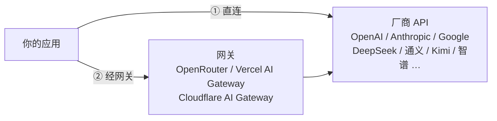

# 03 模型从哪来：云端 API 与网关

> 系列：AI 学习系列教程 · 第一部分 大模型基础
> 配套示例：`ai-learning-examples/part1-basics/src/03-compare.ts`、`03-latency.ts`

前两篇讲了大模型是什么、怎么跟它打交道。在真正写代码调用它之前，还有一个很实际的问题：这个模型在哪？

对大多数应用来说，答案有两种。它可能在厂商的机房里，你直接调厂商的 API；也可能在某个网关后面，由网关替你转发。有意思的是，这两条路对代码的要求几乎一样，大多数时候只是换一个地址、一个 key、一个模型名，但它们在价格、延迟、隐私和稳定性上各有取舍。

本篇先把这两条路走一遍，再聊怎么挑一个合适的模型。

## 一、两条路的全景



不管走哪条路，应用发出去的都是一个 HTTP 请求，内容是第 02 篇讲过的消息列表。区别在于请求发到哪里、谁来收钱、谁能看到你的数据。

当然也可以用 Ollama、vLLM 这类工具在自己的机器上跑开源模型，它们同样提供 OpenAI 兼容接口，但要跑出能胜任 agent 的效果，硬件投入不小，本系列不展开。

## 二、直连厂商

### 2.1 最直接的一条路

直连就是去厂商官网注册、充值、创建 API key，然后把请求发到厂商给的地址上。

这样做最大的好处是能第一时间用上新东西。新模型发布当天，或者某家加了一个新参数（比如调节推理强度、显式控制缓存），总是它自己的接口先支持，其他渠道要等上一阵子。链路也最短，中间没有转发，延迟低，出了问题也只需要找厂商一家。数据只经过你和厂商，合规上只看一份协议就够了。

麻烦在于每接一家都要注册一个账号、维护一份余额、适配一种协议。三家头部厂商恰好各用一种：OpenAI 是 Chat Completions（以及较新的 Responses），Anthropic 是 Messages，Google 是 generateContent。这三种协议第二部分会逐一展开。

### 2.2 地址不总是 `/v1`

国内厂商普遍提供"OpenAI 兼容"的接口，请求和响应长得和 OpenAI Chat Completions 一样，只是地址不同。很多人以为兼容接口的地址都以 `/v1` 结尾，实际上各家的路径五花八门：

| 服务 | OpenAI 兼容地址（baseUrl） | 说明 |
|---|---|---|
| OpenAI | `https://api.openai.com/v1` | 兼容的"原版" |
| DeepSeek | `https://api.deepseek.com` | 带不带 `/v1` 都可以 |
| 阿里云百炼（通义） | `https://dashscope.aliyuncs.com/compatible-mode/v1` | 路径里有 `compatible-mode` |
| 月之暗面（Kimi） | `https://api.moonshot.cn/v1` | |
| 智谱（GLM） | `https://open.bigmodel.cn/api/paas/v4` | 是 `v4` 不是 `v1` |
| 火山方舟（豆包） | `https://ark.cn-beijing.volces.com/api/v3` | 是 `v3`，模型名常是"接入点 ID" |

> 地址以各家官方文档为准，厂商偶尔会调整路径或新增区域。

所以 baseUrl 的准确定义是"拼上 `/chat/completions` 就能用的那一段"，前面是什么由厂商说了算。应用不能只让用户选一个厂商名、自己去补路径，而要让用户直接填完整的地址。

还有一个变化值得留意。DeepSeek、Kimi、智谱、MiniMax 等厂商在 OpenAI 兼容接口之外，又陆续开放了 Anthropic 兼容的入口，主要是为了让 Claude Code 这类只会说 Anthropic 协议的工具也能接进来。于是同一个模型可能同时挂在两个地址、两种协议下，选哪个取决于你的客户端会说哪种话。

## 三、经网关

### 3.1 网关是什么

网关夹在你和厂商之间，接收你的请求，转发给真正的模型，再把结果转回来。按它替你做的事情，大致可以分成两类。

第一类是聚合型。你只需要一个账号、一个 key、一个地址，网关背后接了几十家厂商的几百个模型，账单统一结算。OpenRouter 和 Vercel AI Gateway 都属于这一类，它们对外提供 OpenAI 兼容接口，模型名带着厂商前缀：

```
baseUrl: https://openrouter.ai/api/v1
model:   anthropic/claude-sonnet-4.5     ← 厂商/模型
         qwen/qwen3-235b-a22b
```

想换模型，改 `model` 这一个字符串就行，不用另开账号，也不用改协议。网关在中间把 OpenAI 格式翻译成 Anthropic、Google 等各家的原生格式；某家出故障时，它还能把请求切到同一模型的其他供应方。

第二类是代理型。你仍然用自己在各家厂商的 key，网关只挡在前面，帮你记录请求日志、统计用量、缓存重复的响应、做限流和失败重试。Cloudflare AI Gateway 是典型的例子，用法是把原本的厂商地址换成 `https://gateway.ai.cloudflare.com/v1/{账号}/{网关}/{厂商}`，其余一概不动。

这两类的界限正在变得模糊。聚合型网关大多也允许你填自己的厂商 key，代理型网关也开始提供统一的兼容端点。

### 3.2 什么时候值得用

刚开始学习、想把几家模型都试一遍的时候，聚合型网关最省事，一个 key 就能挨个对比。做产品时如果要支持很多模型，又不想跟每家都签约充值，它也是合适的选择。如果你已经在直连厂商，只是缺少日志、缓存、限流这些基础设施，那么代理型网关更对口。

反过来，当你要用某家刚上线的独有参数时，网关的翻译层可能还没跟上，这时直连更稳妥。对数据合规要求严格的场景也是如此，要么直连，要么认真读一遍网关的数据处理条款。

用网关的代价也要算清楚。请求多了一跳，延迟会增加一些；你的数据多了一方能看到；协议翻译未必完整，推理内容、缓存控制、工具调用这些细节最容易在翻译中走样；价格上也可能有少量加成。

最后要单独提醒一句来路不明的"中转站"。它们常以低价转售海外模型，可你无法验证它背后到底是不是它声称的那个模型，也不知道你的对话会不会被留存。学习时贪便宜尚可理解，生产环境以及任何涉及敏感数据的请求，都不要走这种渠道。

## 四、怎么选一个模型

### 4.1 要看哪些方面

先说能力。公开榜单能帮你缩小范围，但替不了你做决定，因为榜单测的是通用题目，而你的任务可能是"把一句口语化的需求变成一张表格的结构"。最可靠的办法是用自己的任务跑一遍，4.3 节会讲具体怎么做。

再说价格。第 02 篇提到，输入、输出、缓存读写是分开计价的，输出最贵。但比较价格时要结合自己的流量结构来算。agent 每走一步都要重发全部历史，输入量远远大于输出量，缓存命中率的影响也很大，只盯着"每百万输出 token 多少钱"很容易选错，4.2 节会算一笔账来说明。

延迟要按第 02 篇讲过的几个指标分开看。聊天界面对首字延迟（TTFT）很敏感，用户还会在意后面的字来得匀不匀；后台批处理只关心端到端的总耗时。推理模型的首字延迟里包含了思考时间，选它之前要先确认你的场景等得起。

上下文窗口够用就好，但要把工具定义、系统提示和工具结果都算进去，在 agent 场景下，这些内容往往比对话本身还长。另外，窗口大不代表模型在长上下文里依然可靠，第 02 篇提到的"中间迷失"现象在长窗口上更明显。

最容易被忽略、却最容易一票否决的，是功能支持。一个模型支不支持工具调用、能不能并行调用多个工具，流式输出时会不会返回用量，能不能接收图片，是不是推理模型、思考内容放在哪个字段，这些问题都要事先确认。后面两部分的内容全部建立在工具调用之上，一个不支持工具调用或者调用不稳定的模型，能力再强也做不成 agent。

### 4.2 算一笔账

各家的价格调整得很频繁，列一张价目表，过几个月就过时了，所以这里不列具体价格，只讲怎么算。

假设有两个候选模型。A 的输入 4 元、输出 8 元、缓存读取 1 元，单位都是每百万 token；B 的输入 2 元、输出 16 元、缓存读取 0.2 元。只看输出单价，A 便宜一半，似乎是 A 更划算。

现在让它们各跑一个典型的 agent 任务。系统提示加上工具定义一共 8000 token，任务循环 20 步，每步模型输出 300 token，加上工具结果，上下文每步增长 1500 token。第 02 篇讲过，每一步都要把完整的历史重发一遍，所以第 1 步输入 8000 token，第 2 步 9500，第 20 步已经是 36500。20 步加起来，输入一共 44.5 万 token，输出只有 6000 token，输入是输出的七十多倍：

```
输入总量 = 8000 + 9500 + … + 36500
         = 20 × 8000 + 1500 × (0 + 1 + … + 19)
         = 160000 + 1500 × 190
         = 445000 token
输出总量 = 20 × 300 = 6000 token
```

不命中缓存时，44.5 万输入全部按输入单价计费。命中缓存时，第 1 步的 8000 token 是第一次发送，只能按全价算；之后每一步只有新增的 1500 token 按全价，其余部分都是上一步发过的前缀，按缓存读取价计费。这样按全价计费的输入是 8000 + 19 × 1500 = 36500 token，按缓存价计费的是 445000 − 36500 = 408500 token。价格的单位是每百万 token，所以 token 数要先除以一百万，代进去就是：

```
模型 A，不命中缓存：0.445 × 4 + 0.006 × 8                  = 1.780 + 0.048         ≈ 1.83 元
模型 A，命中缓存：  0.0365 × 4 + 0.4085 × 1 + 0.006 × 8     = 0.146 + 0.4085 + 0.048 ≈ 0.60 元
模型 B，不命中缓存：0.445 × 2 + 0.006 × 16                 = 0.890 + 0.096         ≈ 0.99 元
模型 B，命中缓存：  0.0365 × 2 + 0.4085 × 0.2 + 0.006 × 16  = 0.073 + 0.0817 + 0.096 ≈ 0.25 元
```

汇总一下，两个模型的费用如下：

| | 不命中缓存 | 命中缓存 |
| --- | --- | --- |
| 模型 A | 1.83 元 | 0.60 元 |
| 模型 B | 0.99 元 | 0.25 元 |

不管命不命中缓存，输出单价贵一倍的 B 都要便宜得多，因为这种任务的费用几乎全花在输入上。缓存的影响也一目了然：每一步的前缀都是上一步已经发过的内容，只有新增的 1500 token 需要按全价计算，其余 40 多万 token 都按缓存价格计费，总价降到原来的三分之一甚至四分之一。反过来说，要是你在系统提示开头放了一个每次都变的时间戳，缓存一次都命中不了，费用就回到了左边那一列。

所以比较价格时，要先估计自己的流量结构：输入和输出大概是什么比例，缓存能命中多少，再把各家的单价代进去算。聊天类应用的输出占比高一些，agent 和检索类应用则几乎全是输入。

算的时候还有几处容易漏掉的地方。推理模型的思考 token 按输出计价，一道题可能想出几千 token，而这些内容你在回答里根本看不到。显式缓存的厂商对写入缓存往往另收一份费用，比正常输入还贵一点，只有后续命中足够多次才划算。还有一些厂商对超过一定长度的上下文提高单价，或者在夜间等闲时打折，这些都写在定价页的角落里，选之前值得仔细看一遍。

### 4.3 用自己的任务比一比

公开榜单只能帮你缩小范围，真正做决定，还得拿自己的任务去试。这件事不需要什么框架，十几条任务、一个循环就够了。

任务要从真实场景里挑。大部分是最常见的请求，再加几条刁钻的边界情况，比如信息不全、应该先反问的模糊需求，或者需要精确计算、容易出错的地方。数量不用多，10 到 20 条足以拉开差距。

每条任务最好都能用代码判断对错。要求输出 JSON 的，就检查能不能解析、字段值对不对；要求给出一个数字的，就直接比较。这样跑多少遍都不需要人盯着。实在没法用代码判断的，比如文案写得好不好，就把输出保存下来，人工看一遍。

同一条任务要多跑几次。第 02 篇说过，即使把 temperature 设成 0，结果也可能有细微差异，一个模型三次里对两次和三次全对，可靠程度是不一样的。最后，把用量和耗时也一并记下来，这样能力、价格、延迟三件事就能放在同一张表里比较。

配套示例 `03-compare.ts` 就是这样一个最小的对比工具。候选模型写在文件开头的列表里，每个模型填上协议、地址、模型名、读取 key 的环境变量名和假设的单价；四条任务分别是信息抽取、把需求转成列名、一道乘法和一个模糊需求，每条附带一个判断函数：

```ts
{
  name: '信息抽取',
  prompt: '从下面这句话里抽取客户、金额（数字，单位元）、签约日期（YYYY-MM-DD），只输出 JSON，……',
  check: (a) =>
    passes(() => {
      const j = parseJson(a);
      return j.customer === '华星科技' && Number(j.amount) === 125000 && j.date === '2026-10-23';
    }),
},
```

`parseJson` 在解析前会先去掉 Markdown 的代码块标记，因为不少模型即使被要求"只输出 JSON"，还是习惯把它包在 ` ```json ` 里。这种小事在真实项目里很常见，评测时就该把它考虑进去，否则会冤枉一个其实答对了的模型。

设置好对应的环境变量后运行：

```bash
DEEPSEEK_API_KEY=sk-... OPENROUTER_API_KEY=sk-or-... \
  pnpm --filter part1-basics exec tsx src/03-compare.ts
```

```
deepseek-chat        信息抽取     ✓ ✓ ✓
deepseek-chat        需求转结构    ✓ ✓ ✓
deepseek-chat        算术       ✓ ✓ ✓
deepseek-chat        模糊需求     ✗ ✓ ✗
qwen3 (OpenRouter)   信息抽取     ✓ ✓ ✓
……
跳过 claude-sonnet：没有设置 ANTHROPIC_API_KEY

模型                 通过    输入 token  输出 token  费用(元)  平均耗时(ms)
deepseek-chat        10/12          846         702    0.0073          2140
qwen3 (OpenRouter)   11/12          912        1530    0.0105          5380
```

> 以上数字仅为示意，实际结果取决于模型和当时的服务状态。

"模糊需求"那一行用的判断很粗糙，只看回答里有没有问号，这类结果最好再人工看一眼。示例里拼接请求的那段代码同时支持三种协议，地址和请求格式各不相同，第二部分会逐个讲到。

这只是评测的雏形。等到第四、五部分有了 agent，要衡量的就不再是一问一答，而是一整个多步骤的任务做没做成，第 24 章会讲怎么把这件事做成正式的评测。

### 4.4 动手量一量延迟

配套示例 `03-latency.ts` 用流式请求测量首字延迟和输出速度，连测几次后取中位数：

```bash
LLM_BASE_URL=https://api.deepseek.com LLM_API_KEY=sk-... LLM_MODEL=deepseek-chat \
  pnpm --filter part1-basics exec tsx src/03-latency.ts
```

```
第 1 次：首字 1421 ms，总计 4380 ms，输出 92 token，约 31.1 token/s
第 2 次：首字 586 ms，总计 3497 ms，输出 90 token，约 30.9 token/s
第 3 次：首字 603 ms，总计 3541 ms，输出 91 token，约 31.0 token/s

deepseek-chat @ https://api.deepseek.com
首字延迟中位数：603 ms
输出速度中位数：31.0 token/s
```

> 以上数字仅为示意，实际结果取决于网络、时段和模型。

第一次的首字延迟明显偏长，多出来的时间花在了 DNS 解析、TLS 握手这些建立连接的开销上，服务端偶尔也有冷启动。所以测延迟要多测几次取中位数，只看一次是不准的。

示例的关键是在流式循环里，记下第一个非空片段到达的时刻：

```ts
const delta = json.choices?.[0]?.delta;
// 推理模型先吐思考内容，这里也算作「开始有输出」
const piece = delta?.content || delta?.reasoning_content || delta?.reasoning || '';
if (piece && ttft === 0) ttft = performance.now() - started;
```

`reasoning_content` 和 `reasoning` 是不同服务用来放思考内容的两种字段名。这类同一件事各家叫法不同的问题，第 08 章会集中整理。

### 4.5 按什么顺序做决定

实际挑选时，我建议先用功能做筛选。做 agent 就必须支持工具调用，不满足的直接排除，不必在它身上花时间。接着考虑合规：数据能不能出境？如果不能，可选的就只剩国内厂商。然后在剩下的候选里用自己的任务跑一轮对比，挑出两三个能力够用的。最后再按价格和延迟定下主力，同时保留一个备选，主力出故障或涨价时可以随时切换。

保留备选其实是对代码结构提出的要求：不能把某一家厂商写死在代码里。

## 小结

直连厂商新功能来得最快，链路最短，适合承担生产环境的主力模型，代价是每家都要单独开户、单独适配。聚合型网关用一个 key 就能用遍所有模型，学习对比和多模型产品都很方便，但多了一跳转发、多了一方经手数据，协议翻译也未必完整。代理型网关不改变你和厂商的关系，只补上日志、缓存和限流。

挑模型时，先用功能做筛选，再拿自己的任务去比。比价格要按自己的流量结构算，agent 的费用几乎全花在输入上，缓存命中与否能让总价差出好几倍；比能力则要准备一组能用代码判断对错的真实任务，每条多跑几次。

这几条路有一个共同点：模型都被包在一个 HTTP 接口后面，而接口的形状只有少数几种。只要应用把协议、地址、密钥、模型名交给配置，而不是写死在代码里，就可以在它们之间自由切换。这是后面所有代码的前提，我们要写的 agent 不绑定任何一家厂商。

第一部分到这里就结束了。下一篇进入第二部分，第一站是事实上的行业标准《04 OpenAI Chat Completions》。我们会发出第一个真正的请求，把请求和响应里的字段挨个看清楚。

## 延伸阅读

- 各厂商 API 文档中的"快速开始"与"OpenAI 兼容"章节（DeepSeek、阿里云百炼、Kimi、智谱、火山方舟）。
- OpenRouter、Vercel AI Gateway、Cloudflare AI Gateway 的官方文档。
