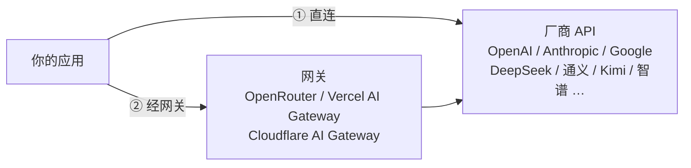

# 03 模型从哪来：云端 API 与网关

> 系列：AI 学习系列教程 · 第一部分 大模型基础
> 配套示例：`pi-leaning-examples/part1-basics/src/03-ping.ts`、`03-latency.ts`、`03-models.ts`

前两篇讲了大模型是什么、怎么跟它打交道。在真正写代码调用它之前，还有一个很实际的问题：这个模型在哪？

对大多数应用来说，答案有两种。它可能在厂商的机房里，你直接调厂商的 API；也可能在某个网关后面，由网关替你转发。有意思的是，这两条路对代码的要求几乎一样，大多数时候只是换一个地址、一个 key、一个模型名，但它们在价格、延迟、隐私和稳定性上各有取舍。

本篇先把这两条路走一遍，再聊怎么挑模型，最后回答一个具体的问题：那些让用户自己填 key 的应用，设置页为什么几乎都是协议、baseUrl、apiKey、model 这四项。

## 一、两条路的全景



不管走哪条路，应用发出去的都是一个 HTTP 请求，内容是第 02 篇讲过的消息列表。区别在于请求发到哪里、谁来收钱、谁能看到你的数据。

当然也可以用 Ollama、vLLM 这类工具在自己的机器上跑开源模型，它们同样提供 OpenAI 兼容接口，但要跑出能胜任 agent 的效果，硬件投入不小，本系列不展开。

## 二、直连厂商

### 2.1 最直接的一条路

直连就是去厂商官网注册、充值、创建 API key，然后把请求发到厂商给的地址上。

这样做最大的好处是能第一时间用上新东西。新模型发布当天，或者某家加了一个新参数（比如调节推理强度、显式控制缓存），总是它自己的接口先支持，其他渠道要等上一阵子。链路也最短，中间没有转发，延迟低，出了问题也只需要找厂商一家。数据只经过你和厂商，合规上只看一份协议就够了。

麻烦在于每接一家都要注册一个账号、维护一份余额、适配一种协议。三家头部厂商恰好各用一种：OpenAI 是 Chat Completions（以及较新的 Responses），Anthropic 是 Messages，Google 是 generateContent。这三种协议第二部分会逐一展开。

### 2.2 地址不总是 `/v1`

国内厂商普遍提供"OpenAI 兼容"的接口，请求和响应长得和 OpenAI Chat Completions 一样，只是地址不同。很多人以为兼容接口的地址都以 `/v1` 结尾，实际上各家的路径五花八门：

| 服务 | OpenAI 兼容地址（baseUrl） | 说明 |
|---|---|---|
| OpenAI | `https://api.openai.com/v1` | 兼容的"原版" |
| DeepSeek | `https://api.deepseek.com` | 带不带 `/v1` 都可以 |
| 阿里云百炼（通义） | `https://dashscope.aliyuncs.com/compatible-mode/v1` | 路径里有 `compatible-mode` |
| 月之暗面（Kimi） | `https://api.moonshot.cn/v1` | |
| 智谱（GLM） | `https://open.bigmodel.cn/api/paas/v4` | 是 `v4` 不是 `v1` |
| 火山方舟（豆包） | `https://ark.cn-beijing.volces.com/api/v3` | 是 `v3`，模型名常是"接入点 ID" |

> 地址以各家官方文档为准，厂商偶尔会调整路径或新增区域。

所以 baseUrl 的准确定义是"拼上 `/chat/completions` 就能用的那一段"，前面是什么由厂商说了算。应用不能只让用户选一个厂商名、自己去补路径，而要让用户直接填完整的地址。

还有一个变化值得留意。DeepSeek、Kimi、智谱、MiniMax 等厂商在 OpenAI 兼容接口之外，又陆续开放了 Anthropic 兼容的入口，主要是为了让 Claude Code 这类只会说 Anthropic 协议的工具也能接进来。于是同一个模型可能同时挂在两个地址、两种协议下，选哪个取决于你的客户端会说哪种话。

## 三、经网关

### 3.1 网关是什么

网关夹在你和厂商之间，接收你的请求，转发给真正的模型，再把结果转回来。按它替你做的事情，大致可以分成两类。

第一类是聚合型。你只需要一个账号、一个 key、一个地址，网关背后接了几十家厂商的几百个模型，账单统一结算。OpenRouter 和 Vercel AI Gateway 都属于这一类，它们对外提供 OpenAI 兼容接口，模型名带着厂商前缀：

```
baseUrl: https://openrouter.ai/api/v1
model:   anthropic/claude-sonnet-4.5     ← 厂商/模型
         qwen/qwen3-235b-a22b
```

想换模型，改 `model` 这一个字符串就行，不用另开账号，也不用改协议。网关在中间把 OpenAI 格式翻译成 Anthropic、Google 等各家的原生格式；某家出故障时，它还能把请求切到同一模型的其他供应方。

第二类是代理型。你仍然用自己在各家厂商的 key，网关只挡在前面，帮你记录请求日志、统计用量、缓存重复的响应、做限流和失败重试。Cloudflare AI Gateway 是典型的例子，用法是把原本的厂商地址换成 `https://gateway.ai.cloudflare.com/v1/{账号}/{网关}/{厂商}`，其余一概不动。

这两类的界限正在变得模糊。聚合型网关大多也允许你填自己的厂商 key，代理型网关也开始提供统一的兼容端点。

### 3.2 什么时候值得用

刚开始学习、想把几家模型都试一遍的时候，聚合型网关最省事，一个 key 就能挨个对比。做产品时如果要支持很多模型，又不想跟每家都签约充值，它也是合适的选择。如果你已经在直连厂商，只是缺少日志、缓存、限流这些基础设施，那么代理型网关更对口。

反过来，当你要用某家刚上线的独有参数时，网关的翻译层可能还没跟上，这时直连更稳妥。对数据合规要求严格的场景也是如此，要么直连，要么认真读一遍网关的数据处理条款。

用网关的代价也要算清楚。请求多了一跳，延迟会增加一些；你的数据多了一方能看到；协议翻译未必完整，推理内容、缓存控制、工具调用这些细节最容易在翻译中走样；价格上也可能有少量加成。

最后要单独提醒一句来路不明的"中转站"。它们常以低价转售海外模型，可你无法验证它背后到底是不是它声称的那个模型，也不知道你的对话会不会被留存。学习时贪便宜尚可理解，生产环境以及任何涉及敏感数据的请求，都不要走这种渠道。

## 四、怎么选一个模型

### 4.1 要看哪些方面

先说能力。公开榜单能帮你缩小范围，但替不了你做决定，因为榜单测的是通用题目，而你的任务可能是"把一句口语化的需求变成一张表格的结构"。最可靠的办法是准备 10 到 20 条真实任务，自己跑一遍看结果。第 24 章会讲怎么把这件事做成正式的评测。

再说价格。第 02 篇提到，输入、输出、缓存读写是分开计价的，输出最贵。但比较价格时要结合自己的流量结构来算。agent 每走一步都要重发全部历史，输入量远远大于输出量，缓存命中率的影响也很大，只盯着"每百万输出 token 多少钱"很容易选错。

延迟要按第 02 篇讲过的几个指标分开看。聊天界面对首字延迟（TTFT）很敏感，用户还会在意后面的字来得匀不匀；后台批处理只关心端到端的总耗时。推理模型的首字延迟里包含了思考时间，选它之前要先确认你的场景等得起。

上下文窗口够用就好，但要把工具定义、系统提示和工具结果都算进去，在 agent 场景下，这些内容往往比对话本身还长。另外，窗口大不代表模型在长上下文里依然可靠，第 02 篇提到的"中间迷失"现象在长窗口上更明显。

最容易被忽略、却最容易一票否决的，是功能支持。一个模型支不支持工具调用、能不能并行调用多个工具，流式输出时会不会返回用量，能不能接收图片，是不是推理模型、思考内容放在哪个字段，这些问题都要事先确认。后面两部分的内容全部建立在工具调用之上，一个不支持工具调用或者调用不稳定的模型，能力再强也做不成 agent。

### 4.2 动手量一量延迟

配套示例 `03-latency.ts` 用流式请求测量首字延迟和输出速度，连测几次后取中位数：

```bash
LLM_BASE_URL=https://api.deepseek.com LLM_API_KEY=sk-... LLM_MODEL=deepseek-chat \
  pnpm --filter part1-basics exec tsx src/03-latency.ts
```

```
第 1 次：首字 1421 ms，总计 4380 ms，输出 92 token，约 31.1 token/s
第 2 次：首字 586 ms，总计 3497 ms，输出 90 token，约 30.9 token/s
第 3 次：首字 603 ms，总计 3541 ms，输出 91 token，约 31.0 token/s

deepseek-chat @ https://api.deepseek.com
首字延迟中位数：603 ms
输出速度中位数：31.0 token/s
```

> 以上数字仅为示意，实际结果取决于网络、时段和模型。

第一次的首字延迟明显偏长，多出来的时间花在了 DNS 解析、TLS 握手这些建立连接的开销上，服务端偶尔也有冷启动。所以测延迟要多测几次取中位数，只看一次是不准的。

示例的关键是在流式循环里，记下第一个非空片段到达的时刻：

```ts
const delta = json.choices?.[0]?.delta;
// 推理模型先吐思考内容，这里也算作「开始有输出」
const piece = delta?.content || delta?.reasoning_content || delta?.reasoning || '';
if (piece && ttft === 0) ttft = performance.now() - started;
```

`reasoning_content` 和 `reasoning` 是不同服务用来放思考内容的两种字段名。这类同一件事各家叫法不同的问题，第 08 章会集中整理。

### 4.3 按什么顺序做决定

实际挑选时，我建议先用功能做筛选。做 agent 就必须支持工具调用，不满足的直接排除，不必在它身上花时间。接着考虑合规：数据能不能出境？如果不能，可选的就只剩国内厂商。然后在剩下的候选里用自己的任务跑一轮评测，挑出两三个能力够用的。最后再按价格和延迟定下主力，同时保留一个备选，主力出故障或涨价时可以随时切换。

保留备选其实是对代码结构提出的要求：不能把某一家厂商写死在代码里。下一节的四项设置就是为此准备的。

## 五、BYOK：四项设置

### 5.1 为什么是这四项

BYOK（Bring Your Own Key）指应用本身不提供模型，由用户填入自己的 key。桌面工具、浏览器插件、开源客户端大多采用这种模式，它们的设置页几乎都收敛到四项：

| 设置项 | 回答的问题 | 例子 |
|---|---|---|
| 协议（api） | 用哪种格式说话 | `openai-completions` / `anthropic-messages` / `google-generative-ai` |
| 地址（baseUrl） | 请求发到哪 | `https://api.deepseek.com`、`https://openrouter.ai/api/v1` |
| 密钥（apiKey） | 你是谁、谁付钱 | `sk-...` |
| 模型（model） | 用哪个模型 | `deepseek-chat`、`anthropic/claude-sonnet-4.5` |

为什么不做成一个厂商下拉框加一个 key 输入框？前面两节已经给出了答案：同一个厂商可能有好几个地址和协议，同一个模型既可以直连也可以经网关获得，新的厂商和自建服务又不断冒出来。只有把协议和地址都交给用户填，应用才能接住所有这些情况。厂商是给人看的概念，代码真正需要的是协议和地址。

### 5.2 地址怎么拼

三种协议拼接路径的规则不一样，这是 BYOK 设置里最常出错的地方：

| 协议 | 官方 baseUrl | 应用拼接的路径 | 鉴权头 |
| --- | --- | --- | --- |
| openai-completions | `https://api.openai.com/v1` | `{baseUrl}/chat/completions` | `Authorization: Bearer {key}` |
| anthropic-messages | `https://api.anthropic.com` | `{baseUrl}/v1/messages` | `x-api-key: {key}` |
| google-generative-ai | `https://generativelanguage.googleapis.com/v1beta` | `{baseUrl}/models/{model}:generateContent` | `x-goog-api-key: {key}` |

注意第二行，Anthropic 的 baseUrl 是不带 `/v1` 的，官方 SDK 会自己补上 `/v1/messages`；Gemini 的 baseUrl 则带着 `/v1beta`。如果用户照着 OpenAI 的习惯，给 Anthropic 也填了 `.../v1`，拼出来就成了 `/v1/v1/messages`，服务器只能回一个 404。

配套示例 `03-ping.ts` 不依赖任何 SDK，用不到一百行把这三种拼法写在了一起：

```ts
function buildRequest(api: string, base: string, model: string, prompt: string): Request {
  switch (api) {
    case 'openai-completions':
      return {
        url: `${base}/chat/completions`,
        headers: { authorization: `Bearer ${KEY}` },
        body: { model, messages: [{ role: 'user', content: prompt }], max_tokens: 200 },
      };
    case 'anthropic-messages':
      return {
        url: `${base}/v1/messages`,
        headers: { 'x-api-key': KEY, 'anthropic-version': '2023-06-01' },
        body: { model, max_tokens: 200, messages: [{ role: 'user', content: prompt }] },
      };
    case 'google-generative-ai':
      return {
        url: `${base}/models/${model}:generateContent`,
        headers: { 'x-goog-api-key': KEY },
        body: { contents: [{ role: 'user', parts: [{ text: prompt }] }] },
      };
    // ...
  }
}
```

光看这一段就能感受到三家的差别。除了路径和鉴权头不同，Anthropic 要求必须填 `max_tokens`，还要带一个版本头；Gemini 把模型名放进了 URL 而不是请求体，消息结构也从 `messages` 换成了 `contents` 和 `parts`。第二部分会把它们逐一展开，第 09 章再把它们收进一个统一层。

四项设置通过环境变量传进去：

```bash
# DeepSeek
LLM_BASE_URL=https://api.deepseek.com LLM_API_KEY=sk-... LLM_MODEL=deepseek-chat \
  pnpm --filter part1-basics exec tsx src/03-ping.ts

# OpenRouter 上的通义千问
LLM_BASE_URL=https://openrouter.ai/api/v1 LLM_API_KEY=sk-or-... LLM_MODEL=qwen/qwen3-235b-a22b \
  pnpm --filter part1-basics exec tsx src/03-ping.ts

# Anthropic（baseUrl 留空即用官方地址）
LLM_API=anthropic-messages LLM_API_KEY=sk-ant-... LLM_MODEL=claude-sonnet-4-5 \
  pnpm --filter part1-basics exec tsx src/03-ping.ts
```

```
POST https://api.deepseek.com/chat/completions
HTTP 200，耗时 1532 ms
用量：输入 21 token，输出 38 token
回答：我是 DeepSeek，由深度求索公司开发的 AI 助手……
```

示例里还有一行不起眼但很实用的处理。用户从文档里复制的地址经常在末尾多一个斜杠，直接拼接就成了 `//chat/completions`，有的服务器会因此返回 404，所以先把它去掉：

```ts
const base = (process.env.LLM_BASE_URL || DEFAULT_BASE_URLS[API] || '').replace(/\/+$/, '');
```

### 5.3 出错时看什么

BYOK 应用还有另一半工作：用户配错了，要能让他知道错在哪。

如果请求根本发不出去，报的是网络错误或者连接被拒，多半是地址写错了，或者访问海外服务需要代理。可以先在浏览器里打开 baseUrl 看看能不能连上。如果服务器回了 404，通常是路径拼错了，多一个或少一个 `/v1`，或者协议选错了，把实际请求的完整 URL 打印出来一看便知。401 和 403 指向 key 的问题，可能填错了、过期了，或者这个 key 没有开通该模型的权限。返回 400 或 404 并且错误信息里提到 model，那就是模型名写错了。429 则是被限流或者余额不足。

处理这些错误的原则只有一条：把服务方返回的错误原文显示给用户。示例遇到非 2xx 的响应，会原样打印响应体，因为厂商自己的错误信息通常比任何猜测都准确，比如它会直接告诉你 "model `deepseek-chats` not found"。

至于模型名到底该怎么写，OpenAI 兼容协议约定了一个列出模型的接口 `GET {baseUrl}/models`，网关和大多数厂商都实现了它。配套示例 `03-models.ts` 调用的就是这个接口：

```bash
LLM_BASE_URL=https://openrouter.ai/api/v1 pnpm --filter part1-basics exec tsx src/03-models.ts qwen
```

```
https://openrouter.ai/api/v1 共 3xx 个模型，含「qwen」的 4x 个：
  qwen/qwen3-235b-a22b
  qwen/qwen3-coder
  ……
```

这个请求只读不写，几乎不花钱，却能同时验证地址和 key 是否正确，拿来做设置页上的"测试连接"按钮再合适不过。

## 小结

直连厂商新功能来得最快，链路最短，适合承担生产环境的主力模型，代价是每家都要单独开户、单独适配。聚合型网关用一个 key 就能用遍所有模型，学习对比和多模型产品都很方便，但多了一跳转发、多了一方经手数据，协议翻译也未必完整。代理型网关不改变你和厂商的关系，只补上日志、缓存和限流。

这几条路有一个共同点：模型都被包在一个 HTTP 接口后面，而接口的形状只有少数几种。只要应用把协议、地址、密钥、模型名这四件事交给配置，就可以在它们之间自由切换。这是后面所有代码的前提，我们要写的 agent 不绑定任何一家厂商。

第一部分到这里就结束了。下一篇进入第二部分，第一站是事实上的行业标准《04 OpenAI Chat Completions》。我们会抓一次完整的请求，把本篇 `03-ping.ts` 里一笔带过的那几个字段挨个看清楚。

## 延伸阅读

- 各厂商 API 文档中的"快速开始"与"OpenAI 兼容"章节（DeepSeek、阿里云百炼、Kimi、智谱、火山方舟）。
- OpenRouter、Vercel AI Gateway、Cloudflare AI Gateway 的官方文档。
